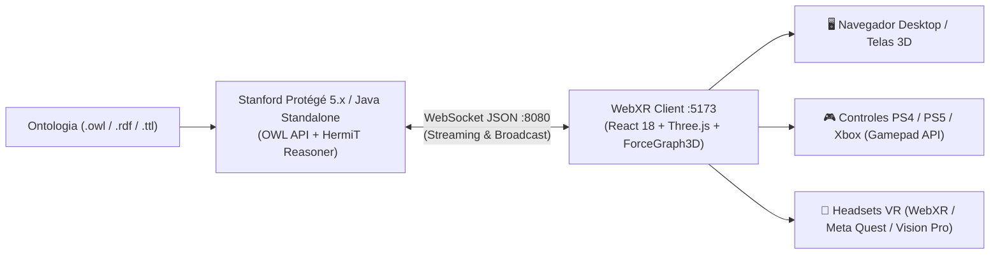

# Registro de Conversa - Antigravity
**ID da Conversa:** `9b2a5771-b2fb-475b-a069-d14100383986`  
**Data/Hora:** 2026-08-31 22:43:03  
**Título / Tema:** rode o projeto    <USER_SETTINGS_CHANGE> The user changed setting `Model Selecti  
**Total de Interações:** 2  

---

## Interação 1
*Data/Hora:* 2026-09-01T00:45:08Z

### 👤 Usuária (Lana):
rode o projeto 

<USER_SETTINGS_CHANGE>
The user changed setting `Model Selection` from None to Gemini 3.7 Flash (High). No need to comment on this change if the user doesn't ask about it. If reporting what model you are, please use a human readable name instead of the exact string.
</USER_SETTINGS_CHANGE>

### 🤖 Assistente (Antigravity):
O projeto **OntoXR** foi iniciado com sucesso! 🚀

---

### 🌐 Serviços em Execução

| Componente | Detalhes & Endereço | Status |
| :--- | :--- | :--- |
| **Back-end Java Standalone** | `ws://localhost:8080` (OWL API + WebSocket) | 🟢 **Ativo** |
| **Front-end WebXR Client** | [http://localhost:5173](http://localhost:5173/) (React + Three.js + Vite) | 🟢 **Ativo** |

---

### 📊 Dados da Ontologia Carregada (`BioHack.owl`)
- **Total de Classes:** 33
- **Total de Entidades / Indivíduos:** 28
- **Total de Relações / Links:** 103
- **Status da Conexão:** `Conectado ao Protégé`

---

Você já pode acessar e interagir com o grafo 3D diretamente pelo navegador em **[http://localhost:5173](http://localhost:5173/)**.

**Ações executadas:**
- Ação de ferramenta

---

## Interação 2
*Data/Hora:* 2026-09-01T01:41:55Z

### 👤 Usuária (Lana):
você consegue me dizer TUDO o que foi feito nesse projeto até o momento?

### 🤖 Assistente (Antigravity):
Aqui está o **resumo completo e estruturado de TUDO o que foi construído e desenvolvido no projeto OntoXR até o momento**, desde a concepção inicial até o estado atual:

---

# 🌐 OntoXR — Panorama Completo do Projeto

O **OntoXR (Ontology Extended Reality Explorer)** é uma plataforma open-source que conecta a **Web Semântica (IA Simbólica / Ontologias OWL / Stanford Protégé)** à **Computação Imersiva (WebXR / 3D / Realidade Virtual)**, permitindo explorar e manipular ontologias complexas em espaço tridimensional interativo.

---

## 🏛️ 1. Arquitetura da Solução

O ecossistema é dividido em dois grandes módulos integrados em tempo real via **WebSockets (porta 8080)**:

---

## ☕ 2. Back-end Java & Plugin Protégé (`plugin-protege/`)

O back-end é um projeto Maven compatível com a arquitetura OSGi do Stanford Protégé 5.x e execuções autônomas.

### Arquivos e Componentes Desenvolvidos:
1. **[`OntoXRViewComponent.java`](file:///c:/Users/Lana/Desktop/OntoXR/plugin-protege/src/main/java/br/ufpe/cin/ontoxr/OntoXRViewComponent.java)**:
   - Integração OSGi como View e Tab nativa no Protégé (`OntoXRView` e `OntoXRTab`).
   - Monitoramento reativo do ciclo de vida do Protégé (`OWLModelManagerListener`), transmitindo atualizações da ontologia aberta em tempo real.
2. **[`OntoXRStandalone.java`](file:///c:/Users/Lana/Desktop/OntoXR/plugin-protege/src/main/java/br/ufpe/cin/ontoxr/OntoXRStandalone.java)**:
   - Executável independente (`main`) que carrega qualquer ontologia local (ex.: `BioHack.owl`) diretamente via OWL API, sem necessi
<truncated 4743 bytes>
o nativa com a Three.js WebXR API e `VRButton`.
- Sessão imersiva ativada com um clique para óculos de RV (Meta Quest 2/3/Pro, HTC Vive, Apple Vision Pro).

---

### 📇 D. Painel de Detalhes, Anotações & Colaboração
- **Card Lateral Interativo**:
  - Nome do Conceito e URI ontológica completa.
  - Descrição semântica extraída do `rdfs:comment`.
  - Propriedades de Dados (`Data Properties`).
- **Sistema de Comentários Colaborativos em Tempo Real**:
  - Usuários podem inserir notas e comentários vinculados a qualquer classe/indivíduo.
  - Sincronização e transmissão instantânea via WebSocket para todos os usuários conectados sem recarregar a tela.

---

### 🔍 E. Busca Inteligente & Suporte Híbrido
- **Barra de Pesquisa (Search & Fly-To)**: Busca nós por nome e aciona uma animação tridimensional suave de aproximação (`focusOnNode`).
- **Suporte Híbrido a Teclado & Mouse**:
  - `Setas` / `A` e `D`: Navegação sequencial cíclica.
  - `Home` / `I`: Início da ontologia.
  - `P`: Modo Apresentação.
  - `C`: Guia de Controles.
  - `O`: Modo Caixas 3D.
  - `R`: Visão Panorâmica (*Zoom to Fit*).
  - `1` e `2`: Filtros de Classes e Entidades.
  - `Espaço` / `Enter`: Abrir/Fechar detalhes.
  - `Esc`: Voltar / Limpar seleção.

---

## 📚 5. Documentação & Histórico Registrado

1. **[`PRD.md`](file:///c:/Users/Lana/Desktop/OntoXR/PRD.md)**: Documento de Requisitos de Produto completo com requisitos funcionais (RF-01 a RF-15), não-funcionais (NFR), arquitetura de software e mapeamento de botões.
2. **[`README.md`](file:///c:/Users/Lana/Desktop/OntoXR/README.md)**: Documentação oficial com guia de instalação, execução e diagrama de arquitetura Mermaid.
3. **[`HISTORICO_CONVERSA_ONTOXR.md`](file:///c:/Users/Lana/Desktop/OntoXR/HISTORICO_CONVERSA_ONTOXR.md)**: Log com todas as 36 etapas e decisões de desenvolvimento.
4. **Repositório Git**: Versionado e configurado no branch `main` remoto em **[https://github.com/lanalcantara/ontoXR](https://github.com/lanalcantara/ontoXR)**.

**Ações executadas:**
- Ação de ferramenta

---
